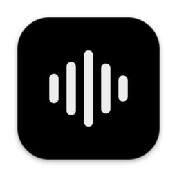
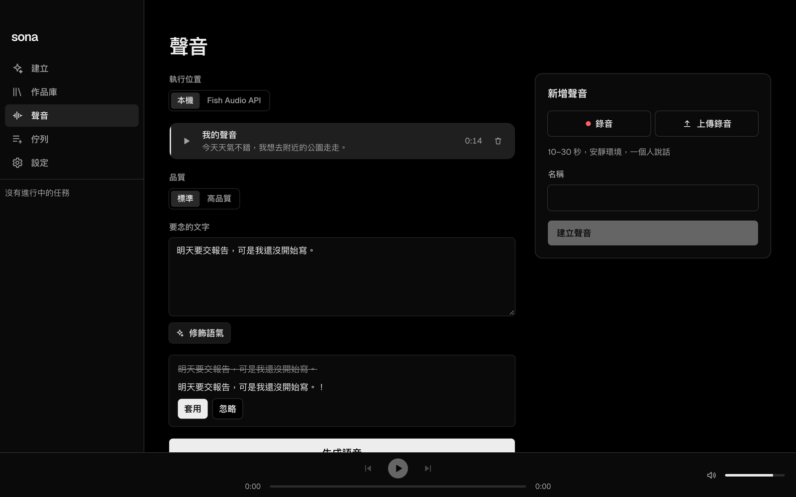

<div align="center">



# Sona

**Open source · Runs on your computer · No account**

Make songs, and speak in your own voice, on your own computer.

[Website](https://sona.dorara.app) · [中文](README.zh-TW.md)

</div>



## What it does

**Clone your voice.** Read a short paragraph aloud for about 15 seconds. After that, type anything and Sona says it in your voice. A 5–7 second sentence takes about 5–10 seconds to generate. Everything runs on your Mac; the recording never leaves it.

**Add feeling to the text.** Written text read aloud can sound flat. Press *Add tone* and your local [Claude Code](https://code.claude.com/docs/en/setup) or [Codex](https://developers.openai.com/codex/cli) rewrites it the way people actually talk, with pauses and little words like "well" or "huh". You see the old and new text side by side and choose whether to use it. Undo works as usual.

**Write songs.** Describe a style ("city pop, female vocal, 96 bpm") and add lyrics, and Sona writes and sings a full song. It can also make instrumentals and re-sing an existing song in a new style.

**Split a song into parts.** Separate any song into vocals, drums, bass and the rest, then mute or solo each one.

## Getting started

The first time Sona opens, it asks what you want to do: make music or clone your voice. It downloads only the models that path needs and shows the size before it starts. You can pause a download and continue later from where it stopped. If you pick your voice, you record and hear your first sentence right there.

Sona shows only the models that fit your computer, so you won't be offered a version that can't run on it.

## Requirements

| | Mac (Apple Silicon) | Windows |
|---|---|---|
| Voice cloning | 16 GB memory or more | — |
| Voice cloning, high quality | 32 GB or more (uses about 26 GB while running) | — |
| Songs, instrumentals, covers | yes | NVIDIA GPU recommended |
| Splitting songs | yes | yes |

Models take a few GB of disk each. Voice cloning needs about 3 GB.

There is no signed download yet. To try it now, build it from source (below).

## Privacy

Your recordings, text and songs stay on your computer. Sona goes online to download models from Hugging Face. *Add tone* sends the text you're rewriting to Anthropic or OpenAI through your own Claude Code or Codex login. Windows can optionally use the Fish Audio API for voice cloning with your own key; that sends the recording and text to Fish Audio. It's off unless you add a key.

## Build from source

Requires Node.js and [uv](https://docs.astral.sh/uv/).

```sh
npm install && npm --prefix frontend install
npm run dev          # the app, with the backend started for you
npm run dist:mac     # builds dist/mac-arm64/Sona.app
```

Tests: `npm test`, `npm --prefix frontend run test:unit`, and `uv run pytest` in `backend/`. Set `SONA_FAKE_ENGINES=1` to run everything with fake engines that finish in seconds. How the parts talk to each other is in [CONTRACT.md](CONTRACT.md).

## License

Sona's code is AGPL-3.0. The models it downloads have their own licenses, and some don't allow commercial use. The YuE2 song model is CC BY-NC 4.0, non-commercial only. Check a model's license on Hugging Face before using its output commercially.
