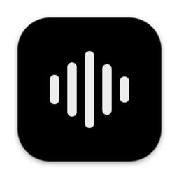
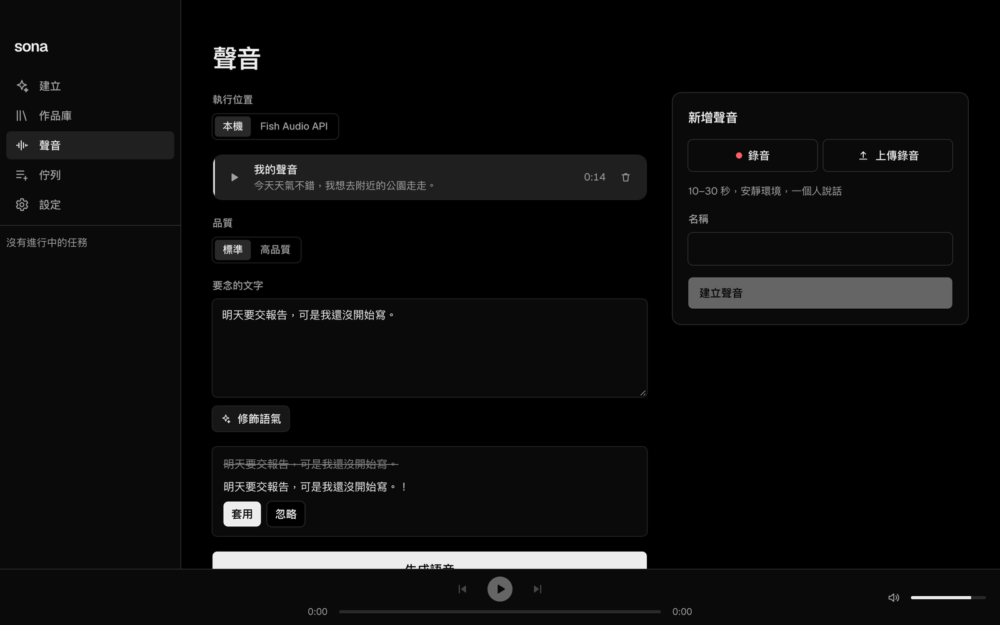

<div align="center">



# Sona

**開源・在自己的電腦上跑・不用帳號**

在自己的電腦上寫歌，也能用你自己的聲音說話。

[官網](https://sona.dorara.app) · [English](README.md)

</div>



## 可以做什麼

**複製你的聲音。** 照著畫面唸一小段話，大約 15 秒。之後打什麼字，Sona 就用你的聲音念出來。一句 5–7 秒的話，大約 5–10 秒生成好。全部在你的 Mac 上執行，錄音不會離開這台電腦。

**幫文字加上語氣。** 照稿念的文字聽起來常常很平。按「修飾語氣」，你電腦上的 [Claude Code](https://code.claude.com/docs/en/setup) 或 [Codex](https://developers.openai.com/codex/cli) 會把它改成真人說話的樣子，加上停頓和「欸」「啦」這類語氣詞。新舊文字並排給你看，要不要套用由你決定，套用後也能復原。

**寫歌。** 描述想要的風格（例如「city pop, female vocal, 96 bpm」）再填上歌詞，Sona 會寫好一首有人聲的歌。也能做純音樂，或把現有的歌換個風格重唱。

**拆軌。** 把任何一首歌拆成人聲、鼓、貝斯和其他，每一軌都能單獨靜音或獨奏。

## 開始使用

第一次打開時，Sona 會問你想做音樂還是複製聲音，只下載那條路需要的模型，開始前會先告訴你檔案多大。下載可以暫停，之後從停下的地方接著下載。選了複製聲音，就在同一個畫面錄音，馬上聽到你的第一句話。

Sona 只列出你這台電腦能用的模型，不會讓你下載跑不動的版本。

## 系統需求

| | Mac（Apple Silicon） | Windows |
|---|---|---|
| 聲音複製 | 記憶體 16 GB 以上 | — |
| 聲音複製（高品質） | 32 GB 以上（執行時約占 26 GB） | — |
| 寫歌、純音樂、翻唱 | 可以 | 建議 NVIDIA 顯示卡 |
| 拆軌 | 可以 | 可以 |

每個模型要幾 GB 的磁碟空間，聲音複製大約 3 GB。

目前還沒有簽好名的安裝檔，想先用要自己從原始碼建置（見下方）。

## 隱私

你的錄音、文字和歌都留在自己的電腦上。Sona 只在從 Hugging Face 下載模型時連網。「修飾語氣」會把你要改寫的文字，透過你自己登入的 Claude Code 或 Codex 送到 Anthropic 或 OpenAI。Windows 可以選擇填自己的 Fish Audio API key 來複製聲音，這時錄音和文字會送到 Fish Audio；沒填 key 就不會用到。

## 從原始碼建置

需要 Node.js 和 [uv](https://docs.astral.sh/uv/)。

```sh
npm install && npm --prefix frontend install
npm run dev          # 開 app，後端會自動啟動
npm run dist:mac     # 建出 dist/mac-arm64/Sona.app
```

測試：`npm test`、`npm --prefix frontend run test:unit`，以及在 `backend/` 裡跑 `uv run pytest`。設定 `SONA_FAKE_ENGINES=1` 會改用幾秒就跑完的假引擎。各部分之間怎麼溝通寫在 [CONTRACT.md](CONTRACT.md)。

## 授權

Sona 的程式碼採用 AGPL-3.0。它下載的模型各有自己的授權，其中有些不允許商用：寫歌用的 YuE2 模型是 CC BY-NC 4.0，只能非商業使用。要商用生成結果之前，先到 Hugging Face 確認該模型的授權。
